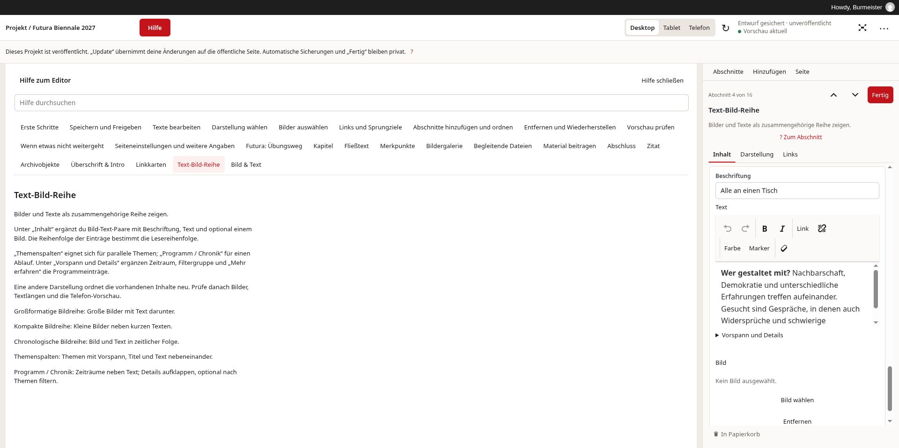
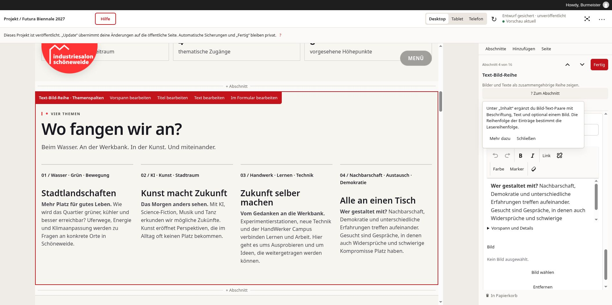

# Projekte bearbeiten — Hilfe zum Abschnittseditor

Dieser Leitfaden begleitet den Futura-Piloten. Du brauchst keine JSON-Kenntnisse.
Die Seite wird aus Abschnitten aufgebaut; du bearbeitest deren Texte, Bilder und
Darstellung im Editor.

## Schnellstart

1. Öffne **Projekte** und das gewünschte Projekt. Für Übungen ohne öffentliche
   Wirkung lege über **Neues Projekt anlegen** ein Testprojekt an.
2. Wähle unter **Abschnitte** den Eintrag, den du bearbeiten möchtest.
3. Ändere unter **Inhalt** zunächst eine Überschrift oder einen kurzen Text.
4. Warte auf **Entwurf gesichert**. Mit **Fertig** sicherst du deinen Arbeitsstand
   und kehrst zur Abschnittsübersicht zurück.
5. Prüfe die Vorschau für **Desktop** und **Telefon**.
6. Verkleinere die Arbeitsfläche, um die normalen WordPress-Speicheraktionen zu
   erreichen. Lies vor dem abschließenden Speichern die Erklärung unten.

## Orientierung und Hilfe

| Bereich | Aufgabe |
| --- | --- |
| Vorschau links | Wirkung von Text, Bildern und Anordnung prüfen. |
| Abschnitte rechts | Abschnitt auswählen, hinzufügen, verschieben oder wiederherstellen. |
| Inhalt / Darstellung / Links / Medien | Die verfügbaren Eigenschaften des ausgewählten Abschnitts bearbeiten. |
| Seite | Seitengestaltung und weitere Einstellungen für das gesamte Projekt. |
| Hilfe oben | Themen und Suchfeld; die Hilfe erscheint anstelle der Vorschau. |
| ? Zum Abschnitt | Erklärung zum ausgewählten Abschnittstyp. |
| Weitere ?-Schaltflächen | Kurze Erklärung; **Mehr dazu** öffnet das passende Hilfethema. |

Die Hilfe bleibt auf großen Bildschirmen neben den Bearbeitungsfeldern geöffnet.
Auf kleinen Bildschirmen wechselst du mit **Hilfe schließen** zurück. **Vorschau**
und **Bearbeiten** schalten zwischen den Arbeitsbereichen um.

Kurze Erklärungen erscheinen beim Überfahren oder beim Fokussieren eines
Steuerelements mit der Tastatur. Mit **Escape** schließt du sie. Auf einem
Touchscreen tippst du auf **?**. Hilfe und Suchfeld verändern keine Inhalte.

### So sieht die Hilfe aus

**Links:** Das gewählte Hilfethema erklärt den Abschnitt und seine Darstellungen.
Über das Suchfeld findest du weitere Themen. **Rechts:** Die Bearbeitungsfelder
bleiben erreichbar. **Oben:** Der Speicherhinweis erklärt die Wirkung für den
aktuellen Inhalt; **Hilfe schließen** bringt die Vorschau zurück.

**? Zum Abschnitt** öffnet die kurze Erklärung. **Mehr dazu** führt direkt zum
passenden Hilfethema. **Schließen** oder **Escape** schließt das Popup und gibt
den Fokus an die auslösende Schaltfläche zurück.

## Speichern: Was wird wann öffentlich?

| Aktion oder Anzeige | Wirkung |
| --- | --- |
| Noch nicht gesichert | Änderungen sind noch nicht bestätigt. Tab offen lassen. |
| Entwurf gesichert | Dein privater Arbeitsstand ist automatisch gesichert. |
| Fertig | Sichert den privaten Arbeitsstand und kehrt zur Übersicht zurück. |
| Vorschau aktualisieren | Sichert den Arbeitsstand und lädt eine Vorschau; veröffentlicht nichts. |
| Entwurf speichern in WordPress | Speichert die gemeinsame Entwurfsfassung. |
| Zur Überprüfung einreichen | Reicht ein neues Projekt zur Prüfung ein; veröffentlicht es nicht. |
| Aktualisieren bei einem veröffentlichten Projekt | Ändert die öffentliche Seite. |
| Veröffentlichen | Veröffentlicht entsprechend Sichtbarkeit und Termin; nur mit entsprechenden Rechten. |

WordPress-Schaltflächen können je nach persönlicher Sprache englisch heißen:
**Save Draft**, **Submit for Review**, **Update** und **Publish**.
Der Hinweis oben im Editor erklärt die Wirkung für den aktuellen Inhalt.

Das UAT-Konto kann Projekte anlegen und bestehende Projekte bearbeiten sowie
Bilder auswählen und hochladen. Neue Projekte veröffentlicht eine Person mit
Veröffentlichungsrechten. **Bereits veröffentlichte Projekte kann das UAT-Konto
öffentlich aktualisieren.** Der Projektstatus, etwa „In Vorbereitung“, ist
unabhängig vom WordPress-Veröffentlichungsstatus.

Warte nach der abschließenden WordPress-Aktion auf deren Bestätigung. Eine
Fehlermeldung oder ein ungültiger Link kann die Übernahme verhindern, obwohl der
private Arbeitsstand gesichert wurde.

## Texte und Links

- **Titel** benennt einen Abschnitt. **Vorspann** ist eine kurze Zeile vor der
  Überschrift; **Einleitung** führt in den Text ein. Beide sind optional.
- Markiere Text, bevor du Fett, Kursiv oder einen Link anwendest. Nutze Absätze
  und Listen zur Gliederung. Prüfe nach dem Einfügen aus Word oder anderen Seiten
  die Formatierung und Links.
- Unterstützte Texte lassen sich auch direkt in der Vorschau bearbeiten.
  **Fertig** übernimmt die Eingabe. **Escape** stellt den Wert vor dieser
  laufenden direkten Texteingabe wieder her.
- Ein Link braucht verständlichen Text und ein vollständiges Ziel. Ein
  unvollständiger Link kann die Vorschau oder abschließende Speicherung blockieren.
- Ein **Anker** ist ein kurzer, eindeutiger Name für ein Sprungziel auf der Seite,
  etwa `programm`. Bereits verlinkte Anker nur nach Prüfung ändern.

## Bilder

1. Wähle beim Abschnitt **Medien → Medien suchen**. Bei Bild-Text-Paaren heißt die
   Aktion **Bild wählen** und steht direkt am Eintrag.
2. Suche ein vorhandenes Bild oder lade eine Datei hoch. Zum Ersetzen entferne
   das bisherige Bild aus der Auswahl und wähle das neue.
3. Prüfe die ausgewählten Miniaturen und bestätige die Auswahl im Medienfenster.
4. Ergänze eine **Bildunterschrift** und prüfe den **Alternativtext** in der
   Mediathek. Änderungen an Mediendaten können andere Bildverwendungen betreffen.
5. Prüfe Bildausschnitt und Lesbarkeit auf Desktop und Telefon.

**Entfernen** am Bild löst dessen Zuordnung; die Mediendatei bleibt erhalten.
Für den Projekt-UAT stehen Mediathek, vorhandene Sets mit freigegebenen Medien
und vorhandene Archivauswahlen zur Auswahl bereit. Sets werden dabei nicht
angelegt oder verwaltet; die Auswahl erfolgt im Projekteditor.

## Die sechs Abschnittstypen im Futura-Piloten

| Typ | Wofür? | Beispiel in Futura |
| --- | --- | --- |
| Bild & Text | Hervorgehobener Einstieg mit Bild, Titel und Text. | „Was machen wir aus morgen?“ als Seitenauftakt. |
| Fließtext | Zusammenhängende Erzählung, je nach Darstellung mit Titel neben dem Text. | „Ein Stadtteil. Viele mögliche Zukünfte.“ |
| Merkpunkte | Kurze Werte und Beschreibungen. | Jahr, Dauer oder andere Eckdaten. |
| Text-Bild-Reihe | Mehrere Bild-Text-Paare, als Themen oder Ablauf angeordnet. | „Wo fangen wir an?“ / „Vom ersten Gespräch bis zur langen Nacht.“ |
| Überschrift & Intro | Leitfrage, Aussage oder Handlungsaufruf. | „Wie blickst du in die Zukunft?“ |
| Kapitel | Ein abgegrenztes Thema vertiefen. | „Wie entsteht das Programm?“ |

Die ausführliche, aktuelle Erklärung steht jeweils unter **? Zum Abschnitt**.
Unter **Darstellung** erklären Skizzen und Hinweise die verfügbaren Varianten.
Eine andere Darstellung ordnet vorhandene Inhalte neu; prüfe anschließend,
welche Inhalte sichtbar sind und wie sich die Seite auf dem Telefon verhält.

Für Futura sind insbesondere **Themenspalten** und **Programm / Chronik** bei
Text-Bild-Reihen relevant. Unter **Vorspann und Details** ergänzt du bei
Programmeinträgen Zeitraum, Filtergruppe und weiterführenden Text.

## Reihenfolge, Papierkorb und Verlauf

Zum Verschieben ziehst du einen Abschnitt am Griff. Mit der Tastatur fokussierst
du den Griff und verwendest Pfeil nach oben oder unten. Die Pfeile **Vorheriger
Abschnitt** und **Nächster Abschnitt** im Bearbeitungsbereich wechseln dagegen
nur die Auswahl.

**In Papierkorb** entfernt einen ganzen Abschnitt. **Rückgängig** oder
**Abschnitte → Papierkorb → Wiederherstellen** holt ihn zurück. Prüfe danach die
Position. Einzelne Fakten, Links oder Bild-Text-Paare haben keinen eigenen
Papierkorb.

Frühere gespeicherte Fassungen sind, sofern vorhanden, unter **Weitere
Werkzeuge → Verlauf** erreichbar. Eine Wiederherstellung dort betrifft den
Inhalt als Ganzes; sie ist kein Rückgängig für ein einzelnes Feld.

## Wenn etwas nicht weitergeht

| Situation | Vorgehen |
| --- | --- |
| Unveröffentlichter Entwurf vorhanden | Bewusst wählen: weiterbearbeiten oder verwerfen. Verwerfen entfernt diesen privaten Arbeitsstand. |
| Ungültige Angaben | Meldung lesen, betroffenes Feld korrigieren und Vorschau erneut prüfen. |
| Andere Person bearbeitet den Inhalt | Mit ihr abstimmen; laufende Arbeit nicht ungeprüft übernehmen. |
| Anmeldung hat sich geändert | Ungesicherte Texte kopieren und den Editor über den angebotenen Link neu öffnen. |
| Netzwerk- oder Speicherfehler | Tab offen lassen, ungesicherte Texte kopieren und nach Wiederherstellung der Verbindung erneut versuchen. |
| Vorschau zeigt eine alte Fassung | Status prüfen und Vorschau aktualisieren. Ein Fehler kann die vorige Vorschau sichtbar lassen. |

## Übungsweg und Rückmeldung

Verwende für Übungen ein Testprojekt als Entwurf. Auf einer veröffentlichten
Futura-Seite verändert **Aktualisieren** den öffentlichen Inhalt.

- Eine Überschrift ändern und die automatische Sicherung erkennen.
- Ein Bild auswählen und beschriften.
- Eine Text-Bild-Reihe in zwei Darstellungen prüfen.
- Einen Abschnitt mit Maus und Tastatur verschieben.
- Einen Abschnitt entfernen und wiederherstellen.
- Desktop und Telefon prüfen; erklären, was **Fertig** und die abschließende
  WordPress-Aktion bewirken.

Halte bei Problemen fest: Abschnitt, Schaltfläche, erwartetes Ergebnis,
tatsächliches Ergebnis und bei Darstellungsproblemen Browser/Bildschirmgröße.
Ziel des Piloten: Diese Aufgaben sind mit der eingebauten Hilfe ohne mündliche
Erklärung durchführbar.

## Pflege der Hilfe

Dieser Leitfaden ist der Einstieg. Die eingebauten Abschnittserklärungen kommen
mit Bezeichnungen und Darstellungshinweisen aus der gemeinsamen Format-Registry.
Die technischen Zuständigkeiten und Prüfungen stehen in
[Editorial Platform](../../docs/architecture/editorial-platform.md).
